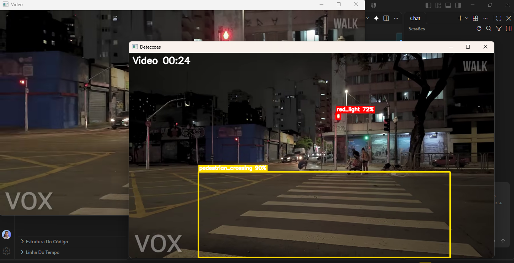

# 🚦 Assistente de semáforo para pedestres

Programa de visão computacional que assiste a um vídeo de rua e avisa, em tempo
real, se há **faixa de pedestre** à frente e qual é a **cor do semáforo**.



---

## 📌 Sumário
1. [O que ele faz](#-o-que-ele-faz)
2. [Como executar](#-como-executar)
3. [Configuração (.env)](#️-configuração-env)
4. [Como funciona](#-como-funciona)
5. [Estrutura do projeto](#-estrutura-do-projeto)
6. [Evidências](#-evidências)
7. [Problemas comuns](#-problemas-comuns)

---

## ✨ O que ele faz
- Toca um vídeo do YouTube numa janela (**Video**), sem precisar baixar.
- A cada **0,5 s** envia o frame atual para um modelo de detecção de objetos
  (YOLOv8n hospedado no [Roboflow](https://universe.roboflow.com/pedestrain-light-crossing/pedestrian-light-crossing-uoz6o)),
  que reconhece 4 classes: `pedestrian_crossing`, `green_light`, `red_light` e `vehicle`.
- Imprime no terminal uma mensagem para o pedestre:

  | Faixa? | Semáforo | Mensagem |
  |---|---|---|
  | ✅ | 🟢 verde | Faixa de pedestre e semáforo verde a frente |
  | ✅ | 🔴 vermelho | Faixa de pedestre e semáforo vermelho a frente |
  | ✅ | — | Faixa de pedestre sem semáforo a frente |
  | ❌ | 🟢 verde | Semáforo verde a frente (sem faixa de pedestre) |
  | ❌ | 🔴 vermelho | Semáforo vermelho a frente (sem faixa de pedestre) |
  | ❌ | — | ----------Nada relevante pode ser detectado---------- |

  > Detecções com confiança abaixo de 50% são ignoradas. Se aparecerem verde e
  > vermelho no mesmo frame, vale o de maior confiança.
- Mostra o último frame com detecção, com as caixas desenhadas, numa segunda
  janela (**Deteccoes**), atualizada junto com a mensagem do terminal.

---

## 🚀 Como executar

> Pré-requisitos: **Python 3.10+** e uma conta gratuita no [Roboflow](https://roboflow.com/).

**1. Baixe o projeto e entre na pasta**
```powershell
git clone https://github.com/PedroHMellow/GS7-APPLIED-COMPUTER-VISION.git
cd GS7-APPLIED-COMPUTER-VISION
```

**2. Crie e ative o ambiente virtual** (só na primeira vez)
```powershell
python -m venv venv
.\venv\Scripts\Activate.ps1
```
> Se o PowerShell bloquear a ativação, rode `Set-ExecutionPolicy -Scope CurrentUser RemoteSigned` e tente de novo.
> No Linux/macOS: `source venv/bin/activate`.

**3. Instale as dependências** (só na primeira vez)
```powershell
python -m pip install -r requirements.txt
```

**4. Coloque sua chave do Roboflow num arquivo `.env`**

No Roboflow, vá em **Settings → API Keys → Generate New Key** e crie, na pasta do
projeto, um arquivo chamado `.env` com:
```
ROBOFLOW_API_KEY=sua_chave_aqui
```

**5. Rode**
```powershell
python main.py
```

Vão abrir as janelas **Video** e **Deteccoes**, e as mensagens aparecem no terminal:
```
        >Processando stream do YouTube...
Stream pronto: formato 398 (720p)
Rodando... (Q ou ESC para sair)

[00:05] ----------Nada relevante pode ser detectado----------
[00:06] Faixa de pedestre sem semáforo a frente
[00:23] Faixa de pedestre e semáforo vermelho a frente
```

**Para sair:** aperte **Q** ou **ESC** na janela do vídeo (ou `Ctrl+C` no terminal).

---

## ⚙️ Configuração (.env)

| Variável | Obrigatória | Padrão | Para que serve |
|---|---|---|---|
| `ROBOFLOW_API_KEY` | ✅ | — | Sua chave de API do Roboflow |
| `VIDEO_URL` | ❌ | [vídeo padrão](https://www.youtube.com/watch?v=zIIIr0ZFQY4) | Link público de outro vídeo do YouTube |
| `SALVAR_ETAPAS` | ❌ | `0` | `1` salva as imagens de cada etapa do processamento (veja [Evidências](#-evidências)) |
| `MAX_ETAPAS` | ❌ | `8` | Quantos frames salvar quando `SALVAR_ETAPAS=1` |

Exemplo de `.env` completo:
```
ROBOFLOW_API_KEY=sua_chave_aqui
VIDEO_URL=https://youtu.be/seu_video
SALVAR_ETAPAS=1
MAX_ETAPAS=12
```

Outros ajustes (intervalo entre análises, confiança mínima, resolução, repetir o
vídeo) ficam no topo do [`main.py`](main.py).

---

## 🧠 Como funciona

```
 Computador (Python + OpenCV)                          Servidor Roboflow
 ┌────────────┐   ┌────────────┐   ┌──────────────┐    ┌──────────────────┐
 │1. Aquisição│ → │2. Amostra- │ → │3. Codificação│ →  │4. Pré-processa-  │
 │ YouTube →  │   │   gem      │   │ JPEG + base64│    │   mento 640x640  │
 │ frame BGR  │   │ 1 a cada   │   └──────────────┘    └────────┬─────────┘
 │ 1280x720   │   │ 0,5 s      │                                ↓
 └────────────┘   └────────────┘                       ┌──────────────────┐
 ┌────────────┐   ┌──────────────────┐                 │5. Inferência     │
 │7. Saída    │ ← │6. Pós-processa-  │ ←────────────── │   YOLOv8n → JSON │
 │ terminal + │   │   mento: filtro  │                 └──────────────────┘
 │ janela     │   │   0,50 + regra   │
 └────────────┘   └──────────────────┘
```

1. **Aquisição** – o `yt-dlp` pega o link direto do vídeo (até 720p) e o OpenCV
   transforma cada quadro numa matriz de pixels BGR 1280x720.
2. **Amostragem** – só 1 frame a cada 0,5 s é analisado, numa thread separada,
   para o vídeo não travar.
3. **Codificação** – o frame é comprimido em JPEG (~18x menor) e enviado em base64.
4. **Pré-processamento** – no servidor, a imagem é esticada para 640x640, igual ao treino.
5. **Inferência** – o YOLOv8n devolve cada objeto encontrado com classe, confiança e caixa.
6. **Pós-processamento** – descarta o que tem menos de 50% de confiança e decide a mensagem.
7. **Saída** – imprime a mensagem e desenha as caixas na janela **Deteccoes**.

**Modelo:** YOLOv8n treinado com 1.506 imagens · mAP@50 75,7% · precisão 84,8% · recall 72,2%.
Dataset: [pedestrian-light-crossing no Roboflow Universe](https://universe.roboflow.com/pedestrain-light-crossing/pedestrian-light-crossing-uoz6o).

---

## 📁 Estrutura do projeto
```
├── main.py                  # programa principal (vídeo, análise e janelas)
├── requirements.txt         # dependências
├── utility/
│   ├── stream_format.py     # link do YouTube → stream direto (yt-dlp)
│   ├── classes.py           # classes do modelo → cor do semáforo / faixa → mensagem
│   └── box_format.py        # desenho das caixas, redimensionamento e carimbo de tempo
└── evidencia/               # prints, log e imagens das etapas de uma execução real
```

---

## 🔍 Evidências
A pasta [`evidencia/`](evidencia) tem o resultado de uma execução real do vídeo padrão:

| Arquivo | O que é |
|---|---|
| `print_00-19_faixa.png`, `print_00-24_faixa_e_vermelho.png`, `print_00-58_verde.png` | Prints da tela com o programa rodando |
| `log_execucao.txt` | Saída completa do terminal (709 análises) |
| `etapas/frame_NNNNN/` | Arquivos gerados com `SALVAR_ETAPAS=1` (imagens completas nos frames 198 e 698) |

Dentro de cada `etapas/frame_NNNNN/`:

| Arquivo | Etapa |
|---|---|
| `1_frame_original.png` | Frame decodificado (matriz BGR 1280x720) |
| `3_frame_enviado.jpg` | JPEG que é enviado ao Roboflow |
| `3_diferenca_jpeg.png` | O que a compressão JPEG alterou (azul = igual, claro = mudou) |
| `4_entrada_modelo_640x640.png` | Frame esticado para 640x640, como o modelo recebe |
| `5_saida_bruta.png` / `5_resposta_modelo.json` | Resposta do modelo, sem filtro |
| `6_apos_filtro.png` | Só as detecções com confiança ≥ 50% |
| `resumo.txt` | Números de cada etapa e a mensagem gerada |

Para gerar de novo: coloque `SALVAR_ETAPAS=1` no `.env` e rode. Para salvar também o log:
```powershell
python main.py > evidencia\log_execucao.txt
```

---

## 🛠️ Problemas comuns

| Problema | Solução |
|---|---|
| `Defina a variável ROBOFLOW_API_KEY` | Falta o arquivo `.env` com a chave, ou ele não está na pasta do projeto |
| `Erro ao consultar o Roboflow: 401/403` | Chave inválida: gere outra no Roboflow |
| `Não foi possível abrir o vídeo` | O link não é público, ou o `yt-dlp` está desatualizado: `python -m pip install -U yt-dlp` |
| `Activate.ps1 não pode ser carregado` | Rode `Set-ExecutionPolicy -Scope CurrentUser RemoteSigned` |
| Só aparece "Nada relevante" | Normal em trechos sem faixa nem semáforo; a janela **Deteccoes** abre na primeira detecção |
